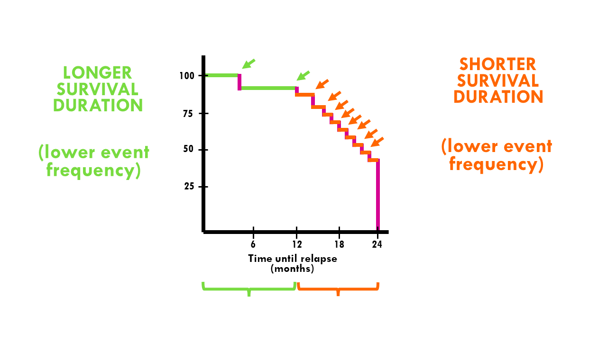

# Week 02: Survival Curves and Leakage Problem

**Project:** Predicting Heart Failure Survival
**Notebook:** `notebooks/02_survival.ipynb`

Last week we said time is off-limits for predicting. 

This week you'll find out exactly why, by using time the right way: to see how fast patients die, not to predict whether they die.

**By the end of this week you will be able to:**

  - Draw and read a Kaplan-Meier survival curve
  - Compare two groups of patients with a log-rank test
  - Explain data leakage in your own words

Plan for about 1.5 hours.

---

## New Ideas : Survival Curves

A Kaplan-Meier Survival Curve shows the share of patients still alive over time. It starts at 100% on day 0.
Each time a patient dies, the curve steps down a little.

Patients who leave the study alive (their follow-up just ended) don't make the curve drop. 
They simply stop being counted from that day on. That's why this curve is fairer than just counting deaths.

Drawing two curves side by side shows which group survives better and how quickly the difference shows up.



---
## Before You Start: Install lifelines

This week needs one extra package, `lifelines` for survival curves.
1. In your terminal, with (.venv) showing, run:
```python
pip install lifelines
```
2. Open `requirements.txt` and add `lifelines` as a new line at the bottom so the file always lists everything the project needs
3. If Jupyter is already running, restart the kernel (Kernel -> Restart Kernel)

> If it won't install, read the last line of error and see whether you missed anything, if not, message project manager (Mint) in Groupme :)

## Step 0: Load the Data

Start the notebook by loading and renaming the data exactly as in Week01

- Open the notebook folder
- Click New → Python 3 (ipykernel)
- Name the notebook 02_survival
 
```python
import pandas as pd
import numpy as np
import matplotlib.pyplot as plt

df = pd.read_csv("../data/raw/heart_failure_train.csv")
df.shape
```
---

## Step 1: Draw the Overall Curve

```python
from lifelines import KaplanMeierFitter

kmf = KaplanMeierFitter()
kmf.fit(df["time"], event_observed=df["DEATH_EVENT"])
kmf.plot_survival_function()
plt.ylabel("probability of survival")
plt.xlabel("days since the start of follow-up")
plt.title("All patients")
plt.savefig("../reports/figures/survival_all.png")
plt.show()
```
`fit()` needs two things: how long each patient was followed (`time`), and whether they died (`DEATH_EVENT`).

The shaded band around the line shows how uncertain the curve is. It gets wider later on because fewer patients are still being followed.

Look at the shape. Is the drop steep at the start, or spread out evenly?

---

## Step 2: Compare High Risk Groups 

Make 4 plots, each comparinf one high-risk group with everyone else:

| Group | Rule
|---|---|---|
| **Weak heart** | ejection_fraction <= 30 |
| **Kidney problems** |	serum_creatinine > 1.5 |
| **Older patients** | age >= 70 |
| **Low sodium** | serum_sodium < 135 |

Here's the first one. 

A **mask** is a column of True/False that picks out one group. 
Then you fit one curve for each side:

```python
mask = df["ejection_fraction"] <= 30

kmf.fit(df["time"][mask], df["DEATH_EVENT"][mask], label="EF <= 30")
ax = kmf.plot_survival_function()

kmf.fit(df["time"][~mask], df["DEATH_EVENT"][~mask], label="EF > 30")
kmf.plot_survival_function(ax=ax)

plt.ylabel("probability of survival")
plt.xlabel("days")
plt.show()
```
> The `~` symbol means "not", so `~mask` is everyone else.
>
> `ax=ax` draws the second curve on the same plot as the first.

**Your turn** : make the other 3 plots.

> **Hint** Only the first line (mask) and the 2 labels change.
> You can copy the cell 3 times or put the 4 masks in dictionary like `{"EF <= 30": df["ejection_fraction"] <= 30, ...}` and loop over it.

---

## Step 3: Add a Log-Rank Test

The curves might look different, 
but with only 209 patients, some difference can happen by chance. 

A **log-rank test** gives a p-value for the question "are these two curves really different?" 

Like last week, p below 0.05 usually means the difference is probably real.


```python
from lifelines.statistics import logrank_test

result = logrank_test(df["time"][mask], df["time"][~mask],
                      df["DEATH_EVENT"][mask], df["DEATH_EVENT"][~mask])
print(result.p_value)
```
The order is: group's times, everyone else's times, group's deaths, everyone else's deaths.

Add the p-value to the title of each of your four plots, for example:

```python
plt.title(f"Weak heart (p = {result.p_value:.1e})")
```
`:.1e` prints a very small number in short form, like 3.6e-04 (which means 0.00036).

Save all four plots to `reports/figures/`

---

## Step 4: Write About Leakage

In a Markdown cell, answer this:

A doctor wants to use your model on the day a new patient arrives. 
- Would the doctor know the patient's time value on that day? 
- Why would using time to predict death be cheating?

**Data Leakage** is when a model gets information it would not reall have at the moment you use it. 

The model looks amazing in your notebook and then fails in real life.

**Questions to answer in writing** :

1. Which group has the biggest gap between its two curves?
2. When do most deaths happen: early or late in the follow-up period?
3. Explain data leakage in 2 to 3 sentences, as if you were telling a friend who doesn't code.

---

## Deliverable

`02_survival.ipynb`, containing:

- [ ] `lifelines` installed and added to `requirements.txt`
- [ ] An overall survival curve, with a sentence describing its shape
- [ ] Four comparison plots, each with its log-rank p-value in the title, saved to reports/figures/
- [ ] Written answers to the three questions in Step 4
- [ ] A short explanation of data leakage in your own words (2 to 3 sentences)

Try clicking Kernel -> Restart Kernel and Run All Cells.
If something breaks, fix it and run again otherwise please reach out!

---

## Check your Answers

- Overall: about 84% of patients are still alive at day 50, about 76% at day 100, and about 58% at the end of follow-up (day 280).
- All four high-risk groups survive clearly worse, and every log-rank p-value is below 0.001.
- Kidney problems (creatinine > 1.5) show by far the biggest gap: about 68% of that group died, against 22% of everyone else (p ≈ 8e-10). The other three groups look similar to each other, with about half dying against about a quarter of everyone else.
- Deaths happen early. About half of all deaths are in the first 50 days, and about 70% are in the first 100. That's exactly why a short `time` gives the answer away: if `time` is short, the patient most likely died.

---

## Common Mistakes

- **Mixing up the two inputs** `fit()` takes the times first and the death column second.
- **Mixing up the order in `logrank_test`** Times, times, deaths, deaths.
- **Reading a tiny p-value as a big effect** The p-value says the gap is probably real. The curves show how big it is.
- **Using `time` as model input** In Week 05, there'll be clearly labeled demonstration.

---

## Next Week

In Week 03, you'll prepare the features and train your first model!
