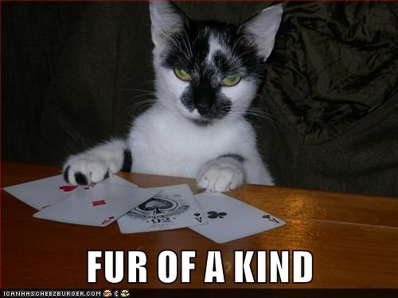

# Week 02: Split the Data and Build Baselines

**Project:** Classifying Poker Hands
**Notebook:** `notebooks/02_baselines.ipynb`

This week you set up an honest way to score models, then train baselines on the **raw** features. The main finding to write up is how badly they do on the rare hands, even when the overall score looks good.

**By the end of this week you will be able to:**

- Split data so each class appears in both parts (a stratified split)
- Explain why accuracy is misleading on imbalanced data
- Measure a classifier with macro-F1, per-class recall, and a confusion matrix
- Describe where models on raw columns fail, and guess why

Plan for about 1 to 2 hours.

---




## Step 1: Split the Data

Use **only `poker_train.csv`** from Week 01. The test file (`poker_test.csv`) should be available after Week 05.

- Open the notebooks folder
- Click **New → Python 3 (ipykernel)**
- Name the `notebook 02_baselines`

```python
import pandas as pd
import numpy as np
import matplotlib.pyplot as plt
from sklearn.model_selection import train_test_split

cols = ["S1", "C1", "S2", "C2", "S3", "C3", "S4", "C4", "S5", "C5", "hand"]
data = pd.read_csv("../data/raw/poker_train.csv", header=None, names=cols)

X = data.drop(columns="hand")
y = data["hand"]

X_train, X_val, y_train, y_val = train_test_split(
    X, y, test_size=0.2, random_state=42, stratify=y
)
print(y_train.value_counts().sort_index())
print(y_val.value_counts().sort_index())
```
- `test_size=0.2` puts 20% of the rows in the validation set.
- `random_state=42` makes the split the same every time you run it. Use 42 in every notebook so we all get the same split.
- `stratify=y` makes sure each class is split in the same proportions. Without it, a rare class could end up entirely in one part.

You now have three pieces of data:

| Piece | Used for | When |
|---|---|---|
| **Training** (80% of the training file) | Fitting models | Weeks 2 to 4 |
| **Validation** (20% of the training file) | Comparing models while you build | Weeks 2 to 4 |
| **Test** (`poker_test.csv`) | One final honest score (about 5,000 hands) | Week 5 only |

**Question:** The rarest classes have only a handful of examples in the whole training file (you counted them in Week 01). How many land in your validation set? What does that mean for trusting a score on those classes?

---

## Step 2: The Accuracy Trap

Let's build the laziest model possible. It ignores the cards completely and always guesses the most common class.

```python
from sklearn.dummy import DummyClassifier
from sklearn.metrics import accuracy_score

dummy = DummyClassifier(strategy="most_frequent")
dummy.fit(X_train, y_train)
print("Accuracy:", accuracy_score(y_val, dummy.predict(X_val)))
```

Write down the accuracy. It will look decent, and the model learned nothing. That's why accuracy alone is not enough here.

---

## Step 3: Better Metrics

| Metric | What it tells you |
|---|---|
| **Per-class recall** | Of the hands that really are class k, what fraction did the model find? |
| **Per-class precision** | Of the hands the model called class k, what fraction really were? |
| **F1** | A single number combining precision and recall for one class |
| **Macro-F1** | The average F1 across all classes, **counting every class equally**, however rare |
| **Confusion matrix** | A grid showing, for each real class, what the model predicted |

Macro-F1 is your main score this week. A model that ignores the rare hands will score low on it even if its accuracy is high.

```python
from sklearn.metrics import classification_report, confusion_matrix, f1_score, ConfusionMatrixDisplay

def report(model, X, y):
    pred = model.predict(X)
    print("Accuracy:", round(accuracy_score(y, pred), 4))
    print("Macro-F1:", round(f1_score(y, pred, average="macro", zero_division=0), 4))
    print(classification_report(y, pred, zero_division=0))
    ConfusionMatrixDisplay.from_predictions(y, pred, normalize="true", values_format=".2f")
    plt.show()

report(dummy, X_val, y_val)
```

`zero_division=0` stops warnings when a class is never predicted. Look at the confusion matrix for the dummy model. What does it look like when a model predicts only one class?

---

## Step 4: Baseline Models on Raw Features

Train these on `X_train` as it is (no changes to the columns):

```python
from sklearn.linear_model import LogisticRegression
from sklearn.tree import DecisionTreeClassifier
from sklearn.ensemble import RandomForestClassifier

models = {
    "logistic regression": LogisticRegression(max_iter=2000),
    "decision tree": DecisionTreeClassifier(random_state=42),
    "random forest": RandomForestClassifier(n_estimators=200, random_state=42, n_jobs=-1),
}

for name, model in models.items():
    model.fit(X_train, y_train)
    print("=" * 20, name)
    report(model, X_val, y_val)
```
The random forest can take a minute. That's normal. You'll probably also see a `ConvergenceWarning` for logistic regression. That's okay for now. It's a hint that the raw columns are hard for it to learn from.

**Your turn** : Collect the results into one table with **accuracy, macro-F1, and recall for each class** for all four models (dummy, logistic regression, decision tree, random forest).

> **Hint**
> 1. Make an empty list before loop like `rows = []`
> 2. Inside the loop, predict on `X_val`, then make a dictionary with the model name, accuracy, macro-F1, and recall for each class. `recall_score(y_val, pred, average=None, zero_division=0)` gives one recall per class.
> 3. After the loop, turn the list into a table with `pd.DataFrame(rows)`
> 4. Don't forget to add the dummy as one of the rows.

Save the confusion matrix of your best model to reports/figures/ (use `plt.savefig(...)` before `plt.show()`).

---

## Step 5: Make Sense of the Results

Answer in writing:

1. Which model has the highest accuracy? Which has the highest macro-F1? Are they the same?
2. How do the models do on class 0 and class 1 (the common ones) compared with classes 5 to 9 (the rare ones)?
3. Why can logistic regression struggle here? (Think: does a pair correspond to one column being bigger or smaller? What would "two columns match" look like to a model that only adds up the columns, each times a weight?)
4. Which model do you think does best, and **does it seem to have actually learned the rules**, or is it partly memorizing? How could you tell?

**Expect** the raw-feature models to do poorly on the rare hands. That is the finding. You'll improve it next week by changing how the hands are represented.

---

## Deliverable

`02_baselines.ipynb`, containing:

- [ ] A stratified split with `random_state=42`
- [ ] The dummy baseline, with a note on what its accuracy shows
- [ ] Three baseline models trained on raw features
- [ ] A table with accuracy, macro-F1, and per-class recall for each model
- [ ] A confusion matrix for your best baseline
- [ ] A short written answer (6-8 sentences): where the baselines fail and why you think so

---

## Common Mistakes

- **Reporting only accuracy.** The dummy model's accuracy already looks decent (you found it in Step 2). Always report macro-F1 and per-class recall.
- **Looking for test file.** Ignore it until Week 5
- **Forgetting `stratify=y`.** A rare class may vanish from validation.
- **Trusting the score on classes with a handful of examples.** One more or fewer correct hand changes recall dramatically. Say how few examples there are.
- **Calling a high score good without a baseline.** Compare with the dummy first.

---

## Answers

- After the split: 14,057 training hands and 3,515 validation hands.
- Validation has only 1 four of a kind, 1 straight flush and 0 royal flushes. All 3 royal flushes ended up in training, so you can’t score that class at all here.
- Dummy: accuracy about 0.50, macro-F1 about 0.07.
- Logistic regression: the same as the dummy. It predicts “Nothing” for every hand.
- Decision tree: macro-F1 about 0.15.
  Random forest: accuracy about 0.58, macro-F1 about 0.13.
- None of the raw-feature models finds a single straight, full house, or anything rarer.

---

## Next Week

In Week 03, you'll design new features that show the model what a poker hand really looks like, then retrain and compare.
