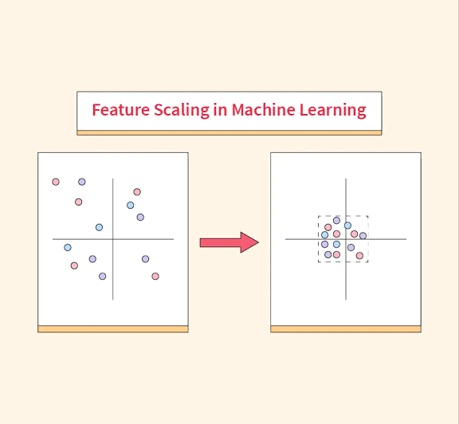

# Week 02: Build a Baseline

**Project:** Predicting Power Plant Output
**Notebook:** `notebooks/02_baseline.ipynb`

Last week you saw that temperature has a very strong and almost straight line relationship with power output. This week you will build your first model! They're simple on purposer : 
- a baseline : gives you a number to beat, so later you can tell whether a fancier model is actually worth it.

**By the end of this week you will be able to:**

- Explain why we keep a separate test set
- Fit a linear regression with scikit-learn
- Measure a regression model with RMSE, MAE, and R²
- Say whether your model is better than a "no-skill" guess

Plan for about 1 to 1.5 hours

---

## Step 1: Set Up the Training Data

Why keep a test set at all? A model scored on the same data it learned from looks better than it really is, kind of like grading a test with answer key already memorized.

The **test set** is data the model never sees while you're building it, so its score is an honest estimate of how the model will do on new data.

We already did that split for you. Your test file (power_plant_test.csv) comes out in Week 05. Until then, everything uses power_plant_train.csv

Open the notebooks folder, click New -> Python 3 (ipykernel), and name the notebook 02_baseline.

```python
import pandas as pd
import numpy as np
import matplotlib.pyplot as plt

df = pd.read_excel("../data/raw/power_plant_train.csv")

X_train = df[["AT", "V", "AP", "RH"]]   # the four measurements (inputs)
y_train = df["PE"]                       # power output (what we predict)
print(X_train.shape, y_train.shape)
```
By convention, X holds the inputs and y holds the target. You'll see these names in every notebooks from now on.

> **Rule from now on:** you only need to build and tune model on the training data. The test file is used once, at the very end (Week 05)
---

## Step 2: The Simplest Possible Model

A **dummy baseline** ignores the four measurements completely and always predicts the average power output from the training data. It has no skill at all, so any real model should beat it easily.

```python
from sklearn.dummy import DummyRegressor

dummy = DummyRegressor(strategy="mean")
dummy.fit(X_train, y_train)
```

---

## Step 3: Linear Regression

Linear regression finds the straight-line formula that fits the data best:

PE ≈ intercept + (coefficient × AT) + (coefficient × V) + (coefficient × AP) + (coefficient × RH)

```python
from sklearn.linear_model import LinearRegression

lin = LinearRegression()
lin.fit(X_train, y_train)

print("Coefficients:", dict(zip(X_train.columns, lin.coef_.round(3))))
print("Intercept:", round(lin.intercept_, 3))
```

Each coefficient says how much the predicted PE changes when that measurement goes up by 1 unit, with the other three staying the same. For example, a coefficient of −2 for AT would mean "1 °C hotter → about 2 MW less power".

---

## Step 4: Measure the Models

Three metrics, each answers a slightly different question:

| Metric | What it tells you | Better is |
|---|---|---|
| **RMSE** (root mean squared error) | Typical size of the error, in MW. Punishes big misses more. | Lower |
| **MAE** (mean absolute error) | Average size of the error, in MW. | Lower |
| **R²** | Share of the variation in `PE` the model explains. 1.0 is perfect, 0 is no better than the average. | Higher |

Since you'll score more than one model, put the scoring in a function:

```python
from sklearn.metrics import mean_squared_error, mean_absolute_error, r2_score

def evaluate(model, X, y):
    pred = model.predict(X)
    return {
        "RMSE": np.sqrt(mean_squared_error(y, pred)),
        "MAE": mean_absolute_error(y, pred),
        "R2": r2_score(y, pred),
    }

results = pd.DataFrame({
    "dummy": evaluate(dummy, X_train, y_train),
    "linear": evaluate(lin, X_train, y_train),
}).T
results
```
> .T flips the table so each model is a row.

Note these scores are on the **training** data, which is fine for now. Next week you'll compare models properly with cross-validation.

**Expect:** the dummy model has R² near 0 and a large RMSE. Linear regression should score far better. Your numbers should be close to these: linear regression R² of about 0.93 and RMSE of about 4.6 MW, against R² of 0 and RMSE of about 17 MW for the dummy.

---

## Step 5: Think About Scaling

Some models care about the size of the numbers. AP is around 1,000, while AT is around 20. **Scaling** puts all the measurements on a similar range so no column wins just because its numbers are bigger.

Linear regression doesn't need scaled features, but many models do (kNN, neural networks, regularized models). Scaling means putting features on a similar range.



The rule: **fit the scaler on the training data only**, then apply it to both.
A Pipeline does this for you.

```python
from sklearn.pipeline import make_pipeline
from sklearn.preprocessing import StandardScaler

scaled_lin = make_pipeline(StandardScaler(), LinearRegression())
scaled_lin.fit(X_train, y_train)
evaluate(scaled_lin, X_train, y_train)
```

A `Pipeline` bundles the steps so scaling is always fitted correctly, including during cross-validation. Check: does scaling change linear regression's RMSE? Why or why not?

---

## Step 6: Look at What the Baseline Gets Wrong

A single score hides where the mistakes are. Plot the predictions against the real values:

```python
pred = lin.predict(X_train)

plt.scatter(y_train, pred, s=3, alpha=0.3)
lims = [y_train.min(), y_train.max()]
plt.plot(lims, lims, "r--")
plt.xlabel("Actual PE (MW)")
plt.ylabel("Predicted PE (MW)")
plt.title("Linear regression: predicted vs actual")
plt.savefig("../reports/figures/linear_pred_vs_actual.png")
plt.show()
```

Answer in a Markdown cell:

1. How much better is linear regression than the dummy, in MW?
2. Is the remaining error small or large in practical terms? (Compare the RMSE with the range 3. of PE, about 420 to 495 MW.)
4. Where does the model do worst?
5. Does scaling change the result? Why?

---

## Deliverable

`02_baseline.ipynb`, containing:

- [ ] 'X_train' and 'y_train' set up from power_plant_train.csv
- [ ] The dummy and linear regression models
- [ ] - [ ] The linear regression coefficients, with one sentence explaining what the AT coefficient means
- [ ] A table of RMSE, MAE, and R² for each
- [ ] The scaled pipeline, with your answer to the scaling check
- [ ] A predicted-vs-actual plot, saved to reports/figures/
- [ ] A short written answer (4-6 sentences)

---

## Check Your Answers

- X_train has 6,697 rows and 4 columns.
- Dummy: RMSE ≈ 17.1 MW, MAE ≈ 14.9 MW, R² = 0.
- Linear regression: RMSE ≈ 4.6 MW, MAE ≈ 3.6 MW, R² ≈ 0.93. That's almost 4 times less error than the dummy.
- Coefficients: AT ≈ −1.99, V ≈ −0.23, AP ≈ +0.06, RH ≈ −0.16. So 1 °C hotter means about 2 MW less power, with the others held the same. Temperature does most of the work.
- An RMSE of 4.6 MW is small next to a range of about 75 MW. About 3 out of 4 predictions are within 5 MW.
- Scaling doesn't change the RMSE at all. Linear regression just adjusts its coefficients to match the new scale, so the predictions stay the same.
- The model does worst at the edges. It predicts too low for the highest-output hours and a bit too high for the lowest ones. That's a sign the real relationship bends slightly, which a straight line can't follow.

---

## Common Mistakes

- **Peeking at the test set.** Don't score on `X_test` this week or next.
- **Learning the scaling from data you're testing on.** Always fit the scaler on training data only. A pipeline handles this for you.
- **Forgetting units.** An RMSE of 4.5 means 4.5 MW, not 4.5%.
- **Calling R² "accuracy".** Accuracy is for classification. R² is a different measure.

---

## Next Week

In Week 03, you'll try more flexible models and compare them fairly with cross-validation.
