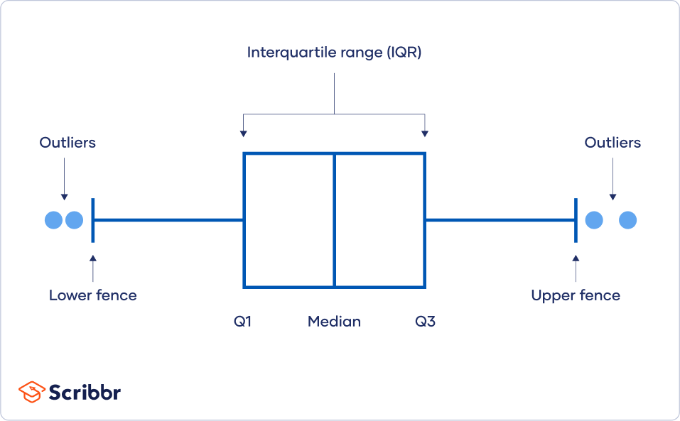

# Week 02: Clean the Data and Build Features

**Project:** Predicting House Prices
**Notebook:** `notebooks/02_features.ipynb`

Last week you explored the data and probably noticed two things: one house with a really suspicious price and some relationships that bend instead of following a straight line.

This week you will deal with the outlier you found and create the new columns that make patterns easier for a model to see.

**By the end of this week you will be able to:**

  - Find outliers using IQR rules
  - Explain what feature engineering is and why it helps
  - Write a function that builds your features the same way every time
  - Save a processed dataset without touching the raw file

Plan for about 1 to 1.5 hours.

---

## Step 0: Load the Data

Start the notebook by loading and renaming the data exactly as in Week01

- Open the notebook folder
- Click New → Python 3 (ipykernel)
- Name the notebook `02_features`
- Load and rename the data the same way as Week01 (see example)
 
```python
import pandas as pd
import numpy as np
import matplotlib.pyplot as plt

df = pd.read_csv("../data/raw/real_estate_train.csv").drop(columns="No")
df.columns = ["trans_date", "house_age", "dist_mrt", "n_stores", "lat", "lon", "price"]
df.head() # show top of the data
```
---

## Step 1: Find the Outlier

The **IQR** (Interquartile Range) is the spread of the middle half of the data. Anything far above it is an extreme outlier.



```python
q1 = df["price"].quantile(0.25)
q3 = df["price"].quantile(0.75)
upper = q3 + 3 * (q3 - q1)
print(upper)
df[df["price"] > upper]
```
An outlier isn't automatically wrong. Some houses are just expensive. Your job is to decide whether it's believable, so compare it with houses that are a similar distance from the metro and a similar age:

```python
similar = df[df["dist_mrt"].between(50, 450) & df["house_age"].between(6, 16)]
similar["price"].describe()

# `.between(a, b)` keeps values from a to b
```

Compare that row with houses that have a similar distance to the metro and a similar age. Is its price believable?

> **Don't delete the outlier in this notebook.** Save your features with it still in. In Week 03 you’ll remove it before training. (The test file doesn’t contain it, since we kept outliers out of it on purpose.)
---

## Step 2: Create New Features

**Feature engineering** means making new columns from the ones you have, so the model can see patterns more easily. Add these four :

| New column | How to create | Why |
|---|---|---|
| **log_dist_mrt** | `np.log1p(df["dist_mrt"])` | Turns the steep then flat curve into something closer to a straight line |
| **trans_month** | `((df["trans_date"] - 2012.75) * 12).round()` | Turns the decimal date into a simple month count |
| **age_sq** | `(df["house_age"] - df["house_age"].mean()) ** 2` | Lets simple models capture the U-shape in age |
| **dist_center_km** | Distance from each house to (24.9765, 121.5395) | The expensive centre you saw on the map |

> **Notes**
> - `np.log1p(x)` means log(1 + x). The "+1" keeps it safe if a distance is ever 0.
> - For the distance to the center: 1 degree of latitude is about 111 km, and 1 degree of longitude is about 111 km × cos(latitude). After that, it's just the Pythagorean theorem.

```python
center_lat, center_lon = 24.9765, 121.5395
km_north = (df["lat"] - center_lat) * 111
km_east = (df["lon"] - center_lon) * 111 * np.cos(np.radians(center_lat))
df["dist_center_km"] = np.sqrt(km_north ** 2 + km_east ** 2)
```
In Week06, you'll need to build **exact same** columns for test file.

> `age_sq` is tricky because it uses the average house age.
> So for test file, you have to use the **training average**, not the test file's own average

Compute it once here, write it down, and pass it into the function.

```python
AGE_MEAN = df["house_age"].mean()   # from the training file. Reuse this exact number in Week 06.
print(AGE_MEAN)

def add_features(data, age_mean):
    out = data.copy()
    center_lat, center_lon = 24.9765, 121.5395
    km_north = (out["lat"] - center_lat) * 111
    km_east = (out["lon"] - center_lon) * 111 * np.cos(np.radians(center_lat))
    out["dist_center_km"] = np.sqrt(km_north ** 2 + km_east ** 2)

    # your turn: add log_dist_mrt, trans_month and age_sq (use age_mean, not out's own mean)
    return out.drop(columns="dist_mrt")
   # For age_sq, use age_mean (the number passed in), NOT out["house_age"].mean()

df = add_features(df, AGE_MEAN)
df.head()
```
> `.copy()` makes a new table, so the function never changes the table you pass in by accident.

Write your `AGE_MEAN` value in a Markdown cell so you have it for Week 06.

---

## Step 3: Check That the Features Helped and Save

```python
df.corr()["price"].sort_values()
# correlation

df.to_csv("../data/processed/house_features.csv", index = False)
#save
```
This goes in `data/processed/`, never `data/raw/`, so you can always start over from the original file.

**Questions to answer in writing** :

1. Which row is the outlier? Why do you think its price is so high?
2. Did `log_dist_mrt` correlate more strongly with price than `dist_mrt` did?
3. Does `dist_center_km` have a strong relationship with price?
4. In one sentence each, why did you create each new feature?
5. Why does `age_sq` have to use the training average, even on the test file later?

---

## Deliverable

`02_baselines.ipynb`, containing:

- [ ] The outlier found, compared with similar houses, and explained in writing (not deleted)
- [ ] `AGE_MEAN` printed and written down in a Markdown cell
- [ ] An `add_features` function that creates all four new columns and drops 'dist_mrt'
- [ ] The correlation check, with a sentence on what changed
- [ ] data/processed/house_features.csv saved
- [ ] Written answers to the 5 questions in Step 3
---

## Check your Answers

- The outlier cutoff is about 103.6. One house is above it, at 117.5. It’s about 250 m from the metro, 10.8 years old, with 1 store nearby. Similar houses sell for around 40-55, so it’s probably a data error or an unusual sale.
- `AGE_MEAN` ≈ 17.1 years.
- `log_dist_mrt` reaches r ≈ −0.73, stronger than −0.67 for the raw distance.
- `dist_center_km` reaches r ≈ −0.69.
- `age_sq` is about +0.29, while `house_age` alone was only −0.20.
  That's the U-shape showing up: very new and very old houses both cost more than middle-aged ones.
- Your saved file should have 290 rows and 10 columns (`dist_mrt` is gone, and 4 new columns were added).

---

## Common Mistakes

- **Deleting outlier too early** It must stay until next week
- **Overwriting the raw file** Always save to data/processed/
- **Making features without saying why.** Every new column needs a reason.

---

## Next Week

In Week 03, you'll split the data and train your first model.
